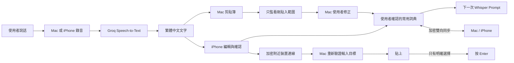
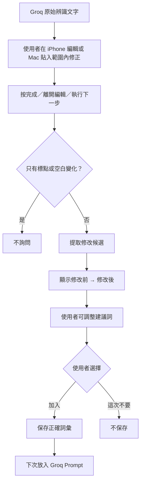
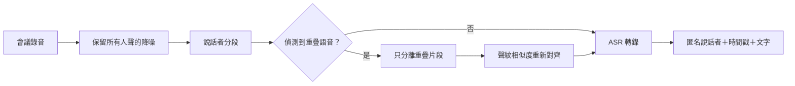

# Groq AI 語音輸入：產品規格與 Roadmap

這是本專案唯一的正式產品方向文件，同時提供給人類與 AI 閱讀。

人類可以先看「產品方向摘要」和「Roadmap」；Codex、Cursor、Claude 或其他 AI 在修改程式前，必須完整閱讀本文件，不能只看 README 或單一程式檔。

實際執行順序、當前驗證證據與未完成清單記錄在 [`plan.md`](plan.md)。`plan.md` 是本文件的執行追蹤器，不能覆蓋本文件的產品規則與安全約束。

## 1. 文件規則

### 1.1 權威順序

發生衝突時，依下列順序處理：

1. 使用者在目前對話中的明確要求。
2. 本文件的產品方向與不可違反規則。
3. 現有程式碼與自動化測試所證明的目前行為。
4. `plan.md` 的目前執行狀態與驗證紀錄。
5. README、舊版 PRD、聊天摘要或其他說明。

如果新的要求會改變安全、付費、資料保存、API 供應商或自動送出規則，AI 必須先更新本文件並說明影響，再開始修改程式。

### 1.2 狀態標記

- `IMPLEMENTED`：已存在於原始碼。
- `VERIFIED`：已完成相對應的自動化或實機驗證。
- `PLANNED`：已規劃，尚未完成。
- `DEFERRED`：保留在 Roadmap，但目前不做。
- `NOT PLANNED`：明確不做。

不得把 `PLANNED` 寫成已經可以使用，也不得只因編譯成功就標成 `VERIFIED`。

## 2. 產品方向摘要

### 2.1 產品使命

讓使用者在 Mac 與 iPhone 快速完成可靠的繁體中文語音輸入；系統只學習使用者明確確認的詞彙，不保存不必要的錄音與逐字稿，也不擅自把內容送出。

### 2.2 目標使用者

- 經常用繁體中文口述長句的人。
- 需要正確保留英文、品牌名、人名、法律與技術詞彙的人。
- 希望用 iPhone 快速錄音，再把文字送到 Mac 的人。
- 不想在本機執行大型 Whisper 模型、也不想處理複雜伺服器的人。

### 2.3 目前正式方向

1. 保留 Mac 版快捷鍵語音輸入。
2. 保留 iPhone 快速喚起、可編輯逐字稿與遠端 Mac 功能。
3. 下一個產品功能是 iPhone「智慧常用詞典」。
4. 智慧詞典確認有效後，再加入主要／備用 Groq Key。
5. 備用 Key 只處理 `401/403` 憑證失效，不處理 `429` 額度輪替。
6. Mac 與 iPhone 的詞典必須雙向同步；先完成 iPhone M1 實機驗證，再沿用已配對的加密連線實作。
7. 驗證期間沿用免費 Personal Team；需要分享給朋友時再進入 TestFlight。
8. 多人會議轉錄列入 M6 未來 Roadmap，規劃為獨立的 Web 微型服務；不得把說話者分離模型加入目前每一次單人語音輸入流程。

## 3. 目前產品基線

### 3.1 Mac App

狀態：`IMPLEMENTED`

- Swift、AppKit、AVFoundation 原生選單列 App。
- Carbon 全域快捷鍵，預設 `Option + ↑`，可自訂。
- 第一次按開始錄音，第二次按停止並辨識。
- 16 kHz、單聲道 AAC `.m4a`。
- 固定呼叫 Groq `whisper-large-v3`。
- `language=zh`，使用繁體中文與台灣用字提示。
- API Key 只存 macOS Keychain。
- 辨識結果先寫入剪貼簿。
- 有 Accessibility 權限才模擬 `Command + V`。
- 沒有權限時保留剪貼簿文字。
- 暫存音檔完成後刪除。
- LaunchAgent 登入啟動。
- Mac 本機快捷鍵永遠只貼上，不按 Enter。
- 可從選單列開啟常用詞典，手動新增、搜尋、編輯、啟用、釘選及刪除。
- 只在 Groq 剛貼入的同一輸入框與文字範圍內，短暫偵測使用者修正並詢問是否加入詞典。
- 修正候選必須由使用者確認後才保存；安全輸入框、純標點、純刪除及貼入範圍外的編輯不產生建議。

### 3.2 iPhone App

狀態：`IMPLEMENTED`

- SwiftUI、AVFoundation、App Intents、Keychain。
- 動作按鈕、背面輕點、Siri、Spotlight 或捷徑快速喚起。
- App 開啟後立即錄音。
- 16 kHz、單聲道 AAC `.m4a`。
- 固定 Groq `whisper-large-v3` 與繁體中文提示。
- 辨識文字可在 `TextEditor` 中修改。
- 可複製、分享或傳到 Mac。
- 支援智慧常用詞典與 Mac 雙向同步。
- 像素黑貓會依待機、錄音、音量與點擊產生反應。

### 3.3 iPhone 與 Mac 遠端功能

狀態：

- 配對與雙端程式：`IMPLEMENTED`
- 首次實機配對：`VERIFIED`
- 所有安全情境：尚未全部 `VERIFIED`

既有設計：

- 使用 Apple Multipeer Connectivity。
- `MCSession` 強制加密。
- 首次用六位數、五分鐘有效的配對碼。
- 只接受已配對裝置。
- iPhone 開始錄音時，Mac 鎖定目前可編輯輸入框。
- Mac 保存 App、視窗、焦點元素與短效工作階段。
- iPhone 顯示目標並提供「只貼上」「貼上並送出」「取消」。
- Mac 執行前重新驗證目標。
- 「貼上並送出」會在貼上後再次驗證，再按 Enter。
- 背景語音或轉錄文字中的「送出」永遠不是操作命令。
- 詞典同步使用版本化協定、穩定詞條 ID、刪除墓碑與決定性合併；重新連線後雙端收斂。

仍需實機逐項驗證：

- [ ] 背面點三下開啟並立即錄音。
- [ ] iPhone 顯示正確的 Mac 輸入目標。
- [ ] 「只貼上」不按 Enter。
- [ ] 「貼上並送出」只執行一次。
- [ ] Mac 焦點改變時拒絕命令。
- [ ] Accessibility 關閉時保留剪貼簿並回報失敗。
- [ ] 睡眠、鎖定與連線中斷時安全失敗。
- [ ] Mac 本機 `Option + ↑` 回歸測試。

### 3.4 2026-07-27 目前交付快照

- Mac `1.3.0 (5)` 已加入詞典管理、雙向同步與貼上後修正建議；自動化測試、正式建置、嚴格簽章驗證與 TextEdit 介面流程已通過。
- Mac 修正監看只讀取剛貼入的精確範圍，最長兩分鐘，不保存完整逐字稿、來源 App 或聊天室。
- iPhone 智慧詞典與雙向同步程式位於本機同層專案 `../groq-ai-voice-input-ios/`；已產生簽章版 `0.6.0 (6)`，目前這一版的實機安裝與同步回歸仍待完成。
- 智慧詞典尚未完成目前這支 iPhone 的實機驗證，因此 M1 仍不能標成完整 `VERIFIED`。
- staged Mac 變更已完成一次 diff-scoped 安全審查；找到 1 個 Medium／P2 與 2 個 Low／P3 問題。依目前決策，先完成智慧詞典驗證，再處理安全修補與真機安全測試。
- 尚未建立乾淨的 iPhone 公開 Repo，也尚未 commit 或 push 這次 Mac 合併版；公開前必須依 `plan.md` 完成私人設定排除與安全門檻。

## 4. 系統架構



Groq 只負責語音轉文字。它不決定是否加入詞典、是否貼上或是否送出。

## 5. 不可違反的產品約束

任何人類或 AI 修改都必須保留：

1. 使用 Swift 原生 Apple 框架，不在本機常駐大型 Whisper 模型。
2. 錄音格式維持 16 kHz、單聲道 AAC `.m4a`。
3. 固定使用 Groq Speech-to-Text 的 `whisper-large-v3`。
4. 使用 `language=zh` 與繁體中文、台灣用字提示。
5. 不加入 ChatGPT、OpenAI API、聊天模型或自動改寫階段。
6. 不加入其他供應商、其他 Groq 模型或付費自動備援。
7. API Key 只能存 Keychain。
8. 不得要求使用者把 API Key 貼進聊天、終端機、程式碼或設定檔。
9. 暫存音檔在所有終止結果後刪除。
10. 沒有 Accessibility 時先保留剪貼簿，不得假裝貼上成功。
11. Mac 本機快捷鍵不得自動按 Enter。
12. 遠端 Enter 只能由 iPhone 明確點擊「貼上並送出」產生。
13. 遠端執行前必須驗證同一 App、視窗、輸入元素、工作階段與期限。
14. 不記錄錄音、逐字稿、詞典或 Authorization header 到日誌。
15. 不自動啟用付費、購買點數或改變 Groq 方案。
16. 不得將「編譯成功」「配對成功」誤寫成所有實機流程均已通過。
17. Mac 只能監看 Groq 剛貼入的同一輸入元素與精確文字範圍，最長兩分鐘；不得讀取或保存整份文件、完整聊天內容或安全輸入框。
18. Mac 的「貼上並送出」不啟動修正監看，避免在 Enter 後仍追蹤已送出的內容。

## 6. PRD A：智慧常用詞典

狀態：`IMPLEMENTED ON BOTH PLATFORMS — MAC UI VERIFIED / IPHONE DEVICE VALIDATION PENDING`

### 6.1 使用者問題

使用者可能每次都要把同一個錯字改正，例如：

```text
Gork → Groq
勞動機準法 → 勞動基準法
```

目前 App 能修改文字，但不會記住使用者確認的正確拼法。

### 6.2 產品目標

當使用者在 iPhone 編輯辨識內容，或在 Mac 修正剛貼入的 Groq 文字時，App 找出可能的正確詞，詢問是否加入常用詞典。只有使用者明確同意才保存。

這不是重新訓練 Whisper。已確認詞彙只會加入下一次 Groq `prompt`，提高正確拼法出現的機會，不保證百分之百正確。

Groq Speech-to-Text 文件目前說明 `prompt` 最多 224 tokens，並用來提供上下文、風格與正確拼法。實作前應再次核對：[Groq Speech to Text](https://console.groq.com/docs/speech-to-text)。

### 6.3 核心流程



### 6.4 功能需求

#### VOC-1 原始版本

Groq 成功後，在本次流程記憶體保存原始文字；完成、取消或重新錄音後清除，不建立逐字稿歷史。

#### VOC-2 詢問時機

- iPhone：使用者按鍵盤「完成」、離開文字框，或準備複製、分享、傳到 Mac。
- Mac：Groq 只貼上後，使用者在同一輸入框的剛貼入範圍內修改，停止輸入約 0.85 秒。
- Mac 監看最長兩分鐘；切換焦點、超出安全範圍或無法重新驗證時立即停止。
- Mac 的「貼上並送出」不啟動修正監看。
- 同一輪編輯最多詢問一次。
- 不在每按一個鍵時詢問。

#### VOC-3 候選提取

- 比對共同前綴與後綴。
- 提取中間修改部分。
- 排除純空白與標點。
- 保留品牌大小寫修正，例如 `groq → Groq`。
- 候選可由使用者修改後再加入。
- 單一中文字預設要求補成完整詞彙。

#### VOC-4 多處修改

多個不連續修改集中到一個審核頁，不連續跳出多個 Alert。

#### VOC-5 詞典管理

- 手動新增。
- 搜尋。
- 編輯。
- 啟用／停用。
- 釘選。
- 個別刪除。
- 清空全部並二次確認。

#### VOC-6 容量

- 單一詞彙 1–40 個可見字元。
- 本機最多保存 200 筆。
- 重複詞不建立第二筆。
- Prompt 優先使用釘選、最近確認及較常使用的詞。
- 不能切斷半個詞來符合 Prompt 上限。

#### VOC-7 資料與隱私

保存：

- 正確詞彙。
- 啟用、釘選、建立時間、更新時間與使用次數。

不保存：

- 完整原始逐字稿。
- 完整修改後逐字稿。
- 錄音歷史。
- 使用該詞的 App 或聊天室。

詞典分別存在 iPhone App 沙盒與 Mac `UserDefaults`，並透過已配對、加密的附近裝置連線雙向同步；不使用 iCloud、不加入分析 SDK。設定頁必須說明：啟用詞會作為 Prompt 的一部分送到 Groq。

Mac 修正監看不保存完整原始／修改後逐字稿，也不保存來源 App、視窗或聊天室；它只在記憶體讀取剛貼入的精確範圍，工作階段結束即清除。

### 6.5 驗收標準

- [x] 修改後只詢問一次。
- [x] 純標點或空白不詢問。
- [x] 建議詞可修改。
- [x] 未按「加入詞典」時不保存。
- [x] 可新增、搜尋、停用、編輯及刪除。
- [x] 重複詞不建立兩筆。
- [x] Prompt 保留基礎繁體中文提示，並以 200 UTF-8 bytes 的保守預算低於 224-token 上限。
- [x] 詞典錯誤可略過，不阻擋複製、分享或遠端傳送。
- [x] 不保存完整逐字稿歷史。
- [x] Mac 只在剛貼入範圍內產生一次建議，安全輸入框與範圍外修改不監看。
- [x] Mac `Gork → Groq` TextEdit 流程顯示可編輯的「加入常用詞典？」確認框。
- [x] Mac／iPhone 詞典同步資料模型、協定與決定性合併測試完成。
- [ ] 至少 20 個指定詞進行加入前後辨識比較。
- [ ] iPhone `0.6.0 (6)` 實機安裝後完成雙向同步回歸。

### 6.6 平台分工

- iPhone 支援編輯後自動建議與完整詞典管理。
- Mac 支援完整詞典管理，並只短暫監看 Groq 剛貼入的同一範圍；不做全系統鍵盤側錄或整份文件監看。
- Mac 與 iPhone 顯示同一份使用者已確認詞典；任何一端的新增、修改、啟用／停用、釘選與刪除都會在重新連線後同步到另一端。
- 同步沿用既有加密配對，只傳詞條與必要管理欄位，不傳 API Key、錄音、完整逐字稿或來源 App。

### 6.7 辨識糾正能力的分層路線

智慧常用詞典是目前優先實作的基礎能力；它把使用者已確認的正確詞放入下一次 Groq `prompt`，降低同一詞反覆辨識錯誤的機率。以下四層是後續糾正能力的技術路線，不得把 `PLANNED` 誤寫成目前已完成。

#### COR-1 同一音訊重新辨識

狀態：`PLANNED — AFTER VOCABULARY VALIDATION`

流程：

1. 本次辨識完成後，短暫保留原音訊。
2. 使用者點「重新辨識」時，以同一音訊再送出一次。
3. 可帶入使用者已確認的常用詞與本輪上下文。
4. 顯示原結果與新結果，由使用者選擇。
5. 使用者接受、取消、逾時或開始下一段錄音後刪除音訊。

約束：

- 不建立長期錄音歷史。
- 不宣稱重新送出一定會得到不同答案。
- 重送會再次消耗 Groq 額度，執行前必須讓使用者知道。
- 第一版先使用按鈕，不把「改」或「重新」當成背景語音命令，避免一般口述內容被誤判成操作。

#### COR-2 候選詞與上下文重排

狀態：`RESEARCH`

若 ASR 供應商能提供 N-best 候選、詞級時間或可信信心度，可用前後文與常用詞典重新排序候選。不得先假設目前 Groq Speech-to-Text 已提供所需的 Top-N／詞級信心資料；實作前要以當時官方 API 文件與真實回應驗證。

產品規則：

- 高信心時可以顯示「建議替換」，但第一版不靜默自動改字。
- 候選必須保留原始辨識結果，讓使用者可一鍵還原。
- 若加入 LLM 或小模型，必須另外評估延遲、成本、隱私、離線能力與模型下載大小。
- LLM 只能排序或提出候選，不能自行觸發貼上或送出。

#### COR-3 選取範圍與語音替換

狀態：`LATER`

使用者先點選錯誤文字，再說「改成咖啡館」；系統只修改明確選取的範圍。這一層需要文字範圍、語音指令解析、復原／重做與衝突處理。

安全與互動規則：

- 沒有明確選取範圍時，不可猜測要替換整句的哪一段。
- 「改成」只編輯草稿，不等同於貼上或送出。
- 每次替換都可復原，且使用者必須看得到修改結果。

#### COR-4 串流辨識與主動提示

狀態：`LATER / EXPERIMENTAL`

ASR 邊錄邊回傳 partial transcript，系統同步準備候選，在使用者說完時提供快速選擇。只有在供應商確實支援穩定串流／partial result、整體延遲與成本達標時才進入實作。

評估門檻：

- 建議出現的目標延遲不高於 500 ms。
- 不因 partial result 頻繁跳字而破壞可讀性。
- 一般錄音與詞典流程仍可獨立運作，串流失敗時能安全退回非串流模式。
- 不把模型預測當成使用者已確認文字。

#### 分層決策

| 優先序 | 能力 | 目前決策 |
|---|---|---|
| Now | 智慧常用詞典 | 先完成實機驗證與辨識前後比較 |
| Next | COR-1 同一音訊重新辨識 | 詞典驗證後做低成本原型 |
| Research | COR-2 候選與上下文重排 | 先確認 Groq／其他 ASR 是否提供必要資料 |
| Later | COR-3 選取後語音替換 | 等基本編輯與復原體驗穩定 |
| Experimental | COR-4 串流主動提示 | 最後評估，不作為目前架構前提 |

## 7. PRD B：Groq 主要與備用 Key

狀態：`PLANNED`

### 7.1 產品目的

允許每台裝置設定一把主要 Key 與一把備用 Key。備用的目的，是主要 Key 被撤銷、無效或權限不足時恢復，不是增加免費額度。

### 7.2 官方限制

Groq 目前說明：

- Rate Limits 主要套用在 organization 層級。
- 超過限制回傳 `429 Too Many Requests`。
- `429` 可能包含 `retry-after`。
- 同一 organization 多建立 Key 通常不會增加整體額度。
- Groq 政策禁止以多帳號或多 organization 協調規避限制。

實作前重新核對：

- [Groq Rate Limits](https://console.groq.com/docs/rate-limits)
- [Groq Projects](https://console.groq.com/docs/projects)
- [Groq API Errors](https://console.groq.com/docs/errors)
- [Groq Acceptable Use Policy](https://console.groq.com/docs/legal/ai-policy)

### 7.3 錯誤規則

| 狀態 | 備用 Key 行為 |
|---|---|
| `401` | 詢問後可用備用 Key 重試一次 |
| `403` | 詢問後可用備用 Key 重試一次 |
| `429` | 不切換；顯示 `retry-after` 或限制說明 |
| `413` | 不切換；音檔大小問題 |
| `400/422` | 不切換；請求內容問題 |
| `5xx` | 不切換 Key；稍後以同一 Key 重試 |
| 網路錯誤 | 不切換 Key；先處理網路 |

### 7.4 功能需求

#### KEY-1 儲存

兩個 Keychain account：

- `groq-api-key-primary`
- `groq-api-key-backup`

完整 Key 不得出現在 UserDefaults、plist、Repo、日誌或剪貼簿。

#### KEY-2 設定介面

- 顯示「主要」「備用」狀態。
- 只顯示最後四碼。
- 可分別更換與刪除。
- 可交換主要與備用。
- 不提供複製完整 Key。
- iPhone 與 Mac 各自設定，不跨裝置同步。

#### KEY-3 有限備援

- 正常請求只使用主要 Key。
- `401/403` 後先詢問使用者。
- 每段錄音最多使用備用 Key 一次。
- 備用仍失敗就停止，不建立輪替迴圈。

#### KEY-4 音檔生命週期

等待備援選擇時，暫存音檔最多保留兩分鐘。取消、成功、失敗、逾時或 App 重啟後刪除。

#### KEY-5 `429`

- 顯示 `retry-after`。
- 提供 Groq Limits 入口。
- 不聲稱另一把 Key 可以解決。
- 不使用多帳號或多 organization 規避限制。

### 7.5 驗收標準

- [ ] 主要與備用 Key 分別存在 Keychain。
- [ ] 正常只使用主要 Key。
- [ ] `401/403` 明確確認後只重試一次。
- [ ] `429` 不切換 Key。
- [ ] `413`、`5xx` 與網路錯誤不切換 Key。
- [ ] 完整 Key 不出現在原始碼、設定、日誌或產物。
- [ ] Key 不透過 iPhone 與 Mac 連線傳送。
- [ ] 既有單 Key 使用者不必重新設定。

## 8. 發佈與維護方向

### 8.1 iPhone 免費 Personal Team

目前 iPhone 使用免費 Apple Account 的 Personal Team。

Apple 目前說明 App ID、測試裝置與 provisioning profile 會在七天後到期，可能需要使用 Xcode 重新建置安裝。失效的不是 Apple ID 帳號。

來源：[Apple Choosing a Membership](https://developer.apple.com/support/compare-memberships/)。

產品決策：

- 功能驗證期間繼續使用免費 Personal Team。
- 接受每七天可能重新安裝。
- 不在功能價值尚未確認前急著付費。

### 8.2 TestFlight

準備讓朋友長期測試時：

- 加入 Apple Developer Program。
- 使用 TestFlight，不要求朋友操作 Xcode。
- Apple 目前說明每個 TestFlight build 最多測試 90 天；持續測試需上傳新 build。

來源：[TestFlight Overview](https://developer.apple.com/help/app-store-connect/test-a-beta-version/testflight-overview/)。

### 8.3 Mac

Mac 不受 iOS Personal Team 七天 provisioning 限制，但若要讓陌生使用者順利下載：

- 使用穩定 Developer ID。
- 送 Apple 公證。
- 保留 bundle ID、安裝位置與簽章身分。
- 發佈 ZIP 與 SHA-256。
- 不移除或繞過 Gatekeeper／quarantine。

## 9. Roadmap


### M0：產品方向確認

狀態：`IN PROGRESS — ONLY INITIAL TEST WORD LIST PENDING`

- [x] 建立單一正式產品規格。
- [x] 使用者確認智慧詞典方向。
- [x] 使用者確認 `429` 不輪替 Key。
- [ ] 選定第一批私下測試詞。

完成門檻：本文件的「下一個開發決策」獲得確認。

### M1：智慧常用詞典 MVP

建議版本：`iOS 0.4.0`

狀態：`IMPLEMENTED LOCALLY — IPHONE VALIDATION PENDING`

範圍：

- 原始／修改文字比較。
- 單一候選詞。
- 詢問後才保存。
- 基本詞典清單。
- Prompt Builder 與長度限制。
- 差異提取及 Prompt 單元測試。

完成門檻：

- [x] 14 個詞典差異、審核輪次、儲存與 Prompt 自動化測試通過。
- [x] iPhone 模擬器完整建置通過。
- [ ] iPhone 實機至少完成 10 組加入／拒絕流程。
- [ ] 在 iPhone 實機確認不影響複製、分享與遠端功能。

### M1.5：主要／備用 Groq Key

建議版本：

- `iOS 0.4.1`
- `macOS 1.1.1`

範圍：

- 兩個 Keychain 項目。
- `401/403` 詢問後備援一次。
- `429` 顯示等待資訊，不切換。
- 暫存音檔兩分鐘上限。

完成門檻：

- Keychain、錯誤路徑與暫存清理測試通過。
- App 產物不含完整 Key。
- 沒有 Key 輪替迴圈。

### M2：詞典品質與管理

建議版本：`iOS 0.5.0`

- 多處修改集中審核。
- 搜尋、編輯、啟用、釘選與清空。
- 詞彙優先度。
- 可關閉修改後詢問。
- 200 筆詞典效能測試。
- 完成 COR-1 同一音訊重新辨識的技術原型與成本／音檔生命週期驗證。
- 研究 ASR 是否提供 COR-2 所需的 N-best、時間資訊與信心度；沒有證據時不得開發假資料介面。

完成門檻：

- 連續日常使用至少七天。
- 建議可接受率目標至少 80%。
- 標點與空白誤提示率目標低於 5%。

### M3：詞典同步到 Mac

建議版本：

- `iOS 0.6.0`
- `macOS 1.2.0`

狀態：`REQUIRED / PLANNED — USER CONFIRMED 2026-07-27`

- 沿用加密 Multipeer Connectivity。
- Mac 與 iPhone 雙向同步，不以 iPhone 單向覆蓋 Mac。
- 只同步使用者確認的詞與必要管理欄位。
- 不同步 Key、錄音或完整逐字稿。
- 支援新增、更新、啟用／停用、釘選與刪除。
- 離線時允許兩端各自管理，重新連線後必須自動收斂成相同結果。
- 實作前必須定義穩定詞條識別、刪除墓碑、重複詞合併與決定性衝突規則；不得只靠兩台裝置的本機時鐘猜測哪一筆較新。
- 同步訊息必須有協定版本；iPhone 與 Mac 的 `RemoteMessages.swift` 必須同時更新並通過相同協定測試。
- Mac Prompt 使用同步詞典。

完成門檻：

- 兩端新增、修改、啟用／停用、釘選與刪除的雙向測試通過。
- 兩端離線各自修改後，重新連線仍能依既定衝突規則收斂。
- 未配對裝置的同步訊息會被拒絕；封包不含 API Key、錄音、完整逐字稿或來源 App。
- Mac 與 iPhone Prompt 都只使用同步後仍啟用的詞。
- 同步協定、重複詞、刪除墓碑、衝突、斷線與版本不相容測試通過。
- 既有遠端貼上安全測試全部完成。

### M4：TestFlight

- 加入 Apple Developer Program 後才開始。
- App Store Connect 建立 App。
- 準備隱私政策、測試說明與聯絡方式。
- 至少一位非開發者可自行安裝、更新與測試。

### M5：公開產品化

方向 A：

- 維持開源＋TestFlight。
- 每位使用者使用自己的 Groq API Key。

方向 B：

- App Store 免費工具。
- 正式隱私標示、支援頁與版本維護。

Mac 同時進入 Developer ID 與公證流程。

### M6：多人會議 Web 微型服務

狀態：`ROADMAP ONLY / NOT STARTED — USER CONFIRMED 2026-08-08`

產品定位：

- 這是未來可上架的 Web 微型服務，不是目前 Mac／iPhone 單人語音輸入的必要依賴。
- 目前 App 繼續負責短句語音輸入；Web 服務負責較長、多人、需要編輯與匯出的會議錄音。
- 第一階段採 Upload-first：「上傳音檔 → 多人逐字稿」，不先做即時會議 Bot、Zoom／Google Meet 串接或背景常駐錄音。

核心流程：

1. 使用者上傳已取得參與者同意的會議音檔。
2. ASR 模型負責辨識「說了什麼」。
3. 評估 `pyannote.audio` 等說話者分段（diarization）工具，標示「誰在什麼時間說話」。
4. 只在偵測到多人重疊說話的片段，評估使用 ClearVoice 等語音分離模型輸出較乾淨的聲道。
5. 使用聲紋嵌入或相似度工具把分離片段接回正確的匿名說話者，避免同一個人在不同片段交換聲道。
6. 將結果對齊成「說話者 A／B／C＋時間戳＋文字」。
7. 使用者可播放對應片段、修改文字、重新命名說話者及匯出結果。

#### 2026-08-09 ClearVoice 本機探索證據

狀態：`RESEARCH VERIFIED / NOT INTEGRATED`

已在 Apple M1、8 GB RAM 的 Mac 上，以官方 Apache-2.0 專案 [ClearerVoice-Studio](https://github.com/modelscope/ClearerVoice-Studio) 和 `MossFormer2_SS_16K` 完成本機語音分離試跑。測試音訊為中文、含背景人聲與噪音，至少可聽見三至四位說話者；本次只擷取前 8 秒進行低風險測試。

實測結果：

- 成功輸出兩條 16 kHz、單聲道、各 8 秒且非靜音的分離音訊。
- 模型下載完成後，第二次啟動的模型載入約 2.36 秒，8 秒推論約 34.48 秒，總計約 36.84 秒。
- 最高常駐記憶體約 1.11 GB，整體峰值約 1.43 GB，未使用 swap；模型權重約 639 MB。
- 官方目前在 Apple Silicon 偵測到 MPS 後仍實際使用 CPU，因此這台 Mac 約需音訊長度 4.3 倍的推論時間；45 秒約需 3 至 4 分鐘，不適合作為即時或長會議的本機主流程。
- 使用者實際試聽確認：即使來源超過兩人，背景噪音與部分重疊人聲仍能有效隔離，分離後的可懂度有改善。
- 已觀察到同一位說話者可能因音量、清晰度或分段邊界而在兩條輸出間交換。這是兩聲道來源分離的限制，不可把輸出聲道直接當成固定人物身分。

適合保留的技術部分：

- `MossFormer2_SS_16K` 與 `decode_one_audio_mossformer2_ss_16k` 的分段推論流程，可列為「重疊語音片段分離」候選，不直接負責整場說話者身分。
- `FRCRN_SE_16K`／`MossFormerGAN_SE_16K` 可列為「保留所有說話者、移除環境噪音」候選，適合在 ASR 前做一般降噪基準測試。
- `pyannote.audio` 的角色應寫為說話者分段；WeSpeaker 或其他 speaker embedding 工具可研究用於聲道重新對齊。三者功能不得混稱為同一件事。
- 正式產品不得整份照搬 Demo；應將降噪、重疊偵測、語音分離、說話者分段、聲紋對齊及 ASR 包成可替換元件，並各自評估準確率、成本、授權、記憶體與延遲。

建議的會議處理順序：



功能邊界：

- `pyannote.audio` 是說話者分段候選方案，不得把 diarization 誤寫成人聲來源分離，也不得宣稱它會直接提高單人 Whisper 的字詞辨識正確率。
- ClearVoice 目前只證明「研究試跑可用」；不得標示成已整合、已適合長會議或能穩定識別真人身分。
- 第一版只標示匿名說話者 A／B／C，使用者自行重新命名；不預設建立可跨會議識別真人身分的聲紋資料庫。
- 不沿用目前「App 不保存完整逐字稿」的客戶端假設；Web 服務必須另行設計使用者可控制的保存期限、立即刪除、權限與加密規則。
- Groq、pyannote 或其他供應商都必須包在可替換的轉錄／說話者分離介面後，先用實際測試決定，不因 Roadmap 提名而鎖定。
- API Key、錄音與逐字稿不得透過目前的 Mac／iPhone Multipeer 詞典同步協定傳送。

Phase 0 驗證門檻：

- 準備 10–20 段已獲授權的真實測試音檔，涵蓋繁體中文、多人、台灣口音、中英混講、噪音及插話。
- 為每段音檔建立人工參考逐字稿與說話者標籤。
- 分開評估文字辨識品質及說話者分段品質，不以單一主觀印象取代測試。
- 比較至少兩種可行組合的正確率、延遲、每小時成本、部署難度與隱私風險。
- 在開始寫正式產品前，完成獨立 PRD、資料保存政策、刪除流程、權限模型與成本上限。

MVP 完成門檻：

- 可上傳常見會議音檔並取得多人逐字稿。
- 可重新命名說話者、點時間戳播放、修改文字。
- 可匯出 TXT、Markdown 與 DOCX。
- 使用者可查看保存期限並立即刪除錄音與產出。
- 失敗時不會把不同說話者錯誤合併成已確認身分，也不會把未完成結果標示為完成。

## 10. Now／Next／Later

| 優先序 | 內容 |
|---|---|
| Now | 依 `plan.md` 完成 M1 智慧詞典實機驗證與 20 個指定詞的加入前後比較 |
| Next | 完成 M3 雙向同步的資料與通訊協定設計；並補完遠端實機安全測試及已確認的 P2／P3 問題，再確認 M1.5、M2／COR-1 與 M3 實作順序 |
| Research | COR-2 候選詞／上下文重排；M6 多人 ASR＋說話者分離基準測試；實作前驗證能力、延遲、成本與隱私 |
| Later | M1.5 主要／備用 Key、M2 詞典品質與 COR-1、M3 雙向同步實作、COR-3、COR-4、M4 TestFlight、M5 App Store／Mac 公證、M6 多人會議 Web 微型服務 |
| Not planned | `429` Key 輪替；目前 Mac／iPhone App 的完整逐字稿歷史；未確認自動學習；背景語音命令自動貼上或送出；M6 第一階段的即時會議 Bot |

## 11. 原始碼地圖

### Mac Repo

目前文件所在 Repo：

```text
groq-ai-voice-input-macos/
```

| 功能 | 位置 |
|---|---|
| 選單列、快捷鍵、錄音、Groq、Keychain、貼上 | `Sources/GroqVoiceInput/main.swift` |
| iPhone 配對與通訊 | `Sources/GroqVoiceInput/MacRemoteBridge.swift` |
| 遠端訊息格式 | `Sources/GroqVoiceInput/RemoteMessages.swift` |
| 目標鎖定、驗證、貼上與 Enter | `Sources/GroqVoiceInput/RemoteTargetController.swift` |
| 純安全驗證規則 | `Sources/GroqVoiceInput/RemoteTargetValidationPolicy.swift` |
| 遠端協定測試 | `Tests/RemoteProtocolTests.swift` |
| 建置 | `scripts/build.sh` |
| 遠端測試 | `scripts/test-remote-protocol.sh` |

### iPhone 專案

本機與 Mac Repo 同層：

```text
../groq-ai-voice-input-ios/
```

| 功能 | 位置 |
|---|---|
| 流程總管 | `../groq-ai-voice-input-ios/Sources/App/AppModel.swift` |
| 主畫面與文字編輯 | `../groq-ai-voice-input-ios/Sources/App/ContentView.swift` |
| 像素黑貓 | `../groq-ai-voice-input-ios/Sources/App/PixelVoiceScene.swift` |
| 錄音 | `../groq-ai-voice-input-ios/Sources/Audio/AudioRecorder.swift` |
| Groq API | `../groq-ai-voice-input-ios/Sources/Groq/GroqClient.swift` |
| Keychain | `../groq-ai-voice-input-ios/Sources/Security/KeychainStore.swift` |
| 快速喚起 | `../groq-ai-voice-input-ios/Sources/Shortcuts/QuickStartIntent.swift` |
| Mac 配對與通訊 | `../groq-ai-voice-input-ios/Sources/Remote/RemoteMacBridge.swift` |
| 遠端訊息格式 | `../groq-ai-voice-input-ios/Sources/Remote/RemoteMessages.swift` |

iPhone 與 Mac 的 `RemoteMessages.swift` 是共用契約。修改時必須同步更新並執行協定測試。

## 12. AI 接手工作流程

任何 AI 在修改前必須：

1. 完整閱讀 `PRODUCT_SPEC.md`。
2. 閱讀 `README.md`、`PRIVACY.md`、`SECURITY.md`。
3. 執行 `git status`，不得覆蓋尚未提交的修改。
4. 確認需求屬於目前版本還是未來 Roadmap。
5. 搜尋所有相關呼叫端與共用通訊格式。
6. 先寫影響範圍與驗證方法，再修改。
7. 使用最小、可審查的變更。
8. 執行相關測試與建置。
9. 明確列出仍需真人操作的麥克風、Accessibility、配對或實機驗證。
10. 更新本文件的狀態，但不得把未驗證項目勾成完成。

### 12.1 禁止 AI 執行

- 不得要求使用者在聊天或終端機提供 Groq API Key。
- 不得把 Key 寫入測試資料或環境檔。
- 不得刪除或重設 macOS TCC 權限。
- 不得變更 bundle ID、簽章或安裝位置而不先警告。
- 不得以 `git reset --hard`、`git checkout --` 等方式清掉修改。
- 不得自動付費或操作 Groq 帳務。
- 不得為了方便安裝而繞過 Gatekeeper。
- 不得用多帳號／多 organization 規避 Groq 限制。

### 12.2 每次交付格式

AI 完成工作時必須報告：

```text
完成內容：
修改檔案：
保留的安全規則：
執行的測試：
實機驗證：
尚未完成：
PRODUCT_SPEC 更新：
```

## 13. 可直接交給其他 AI 的 Prompt

```text
請先完整閱讀 Repo 根目錄的 PRODUCT_SPEC.md，再閱讀 README.md、
PRIVACY.md、SECURITY.md 與相關原始碼。

PRODUCT_SPEC.md 是產品方向、PRD、Roadmap、安全限制與驗收標準的唯一正式來源。
不得把 PLANNED 功能當成已完成，也不得覆蓋現有未提交修改。

修改前請先回報：
1. 這次需求對應哪個里程碑與需求編號。
2. 會修改哪些檔案與共用契約。
3. 必須保留哪些安全規則。
4. 要執行哪些自動化與實機驗證。

絕對不要要求我把 Groq API Key 貼進聊天、終端機、程式碼或設定檔。
不要加入 ChatGPT、OpenAI API、其他模型、付費備援或 429 Key 輪替。

完成後請同步更新 PRODUCT_SPEC.md，但不得把尚未完成的實機測試標成通過。
```

## 14. 決策紀錄

| 日期 | 決策 |
|---|---|
| 2026-07-18 | iPhone 與 Mac 首次加密配對完成，但其餘遠端實機安全情境仍待驗證。 |
| 2026-07-26 | 智慧詞典採「修改後詢問、明確同意才保存」，第一階段只在 iPhone 自動學習。 |
| 2026-07-26 | 多 Key 只提供 `401/403` 憑證備援；`429` 不輪替 Key。 |
| 2026-07-26 | 免費 Personal Team 用於驗證期；朋友長期測試預計使用 TestFlight。 |
| 2026-07-26 | 本文件成為人類與跨 AI 的唯一正式產品規格入口。 |
| 2026-07-26 | 糾正能力採分層路線：先完成常用詞典，再做同音訊重跑；候選重排、選取後語音替換與串流提示依證據逐步研究。 |
| 2026-07-26 | 常用詞典的 14 個核心測試與 iPhone 模擬器建置通過；實機驗證仍是 M1 完成門檻。 |
| 2026-07-26 | Mac staged diff 安全審查完成；安全修補延後到常用詞典驗證後，但必須在公開分享前完成。 |
| 2026-07-27 | 使用者確認 Mac 與 iPhone 詞典必須雙向同步；沿用已配對的加密連線，只同步已確認詞條與管理狀態，不同步 API Key、錄音或完整逐字稿。 |
| 2026-08-08 | 多人會議轉錄加入 M6 未來 Roadmap，定位為獨立 Upload-first Web 微型服務；ASR 負責文字、pyannote 等候選工具負責說話者分段，正式實作前必須完成真實音檔基準、成本與隱私設計。 |
| 2026-08-09 | ClearVoice `MossFormer2_SS_16K` 已在 M1／8 GB Mac 完成 8 秒本機探索；確認降噪與重疊人聲分離具有研究價值，但兩條輸出會交換說話者，只能作為 M6 前處理候選，不能取代 diarization 或聲紋對齊。 |

## 15. 目前執行決策

M1 已完成本機實作。下列產品決策已固定：

- [x] 智慧詞典先做 iPhone 本機版。
- [x] 一輪編輯最多詢問一次。
- [x] 只有按「加入詞典」才保存。
- [x] 第一版不保存完整逐字稿、不使用 iCloud。
- [x] `429` 不切換備用 Key。
- [x] Mac 與 iPhone 詞典列為必做的雙向同步需求；目前仍是 `PLANNED`，不得標示為已完成。
- [x] Personal Team 驗證期間可能每七天重新安裝。

目前唯一的 Now 工作是依 [`plan.md`](plan.md) 完成 M1 實機驗證。安全修補、GitHub 公開版、COR-1、M6 Web 微型服務及其他 Roadmap 功能都不得誤寫成已完成。
