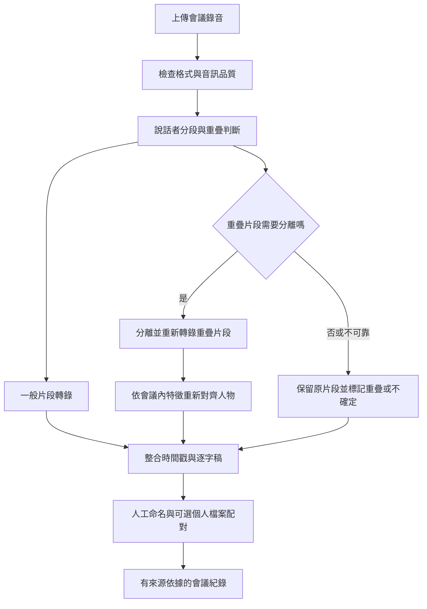

# M6 多人會議服務與個人聲音檔案

狀態：公開服務仍為產品需求／研究候選，尚未上架；已有獨立本機第一階段研究管線，結果見 [驗證報告](MEETING_PHASE1_VALIDATION.md)，自然會議穩定性未通過。此文件連回本分支的 [PRODUCT_SPEC.md](../PRODUCT_SPEC.md)，延續既有 M6，不另起互相矛盾的產品路線。

## 找回的歷史依據

2026-10-14 已重新讀取對話「整理 Groq 語音輸入 Skill」（thread `019f538b-e1eb-7a22-aa98-14857fc45cec`），包含 2026-08-09 的 ClearVoice 試聽與後續架構討論。原本機 PRODUCT_SPEC 的 M6 及「2026-08-09 ClearVoice 本機探索證據」也已唯讀核對。原文件保留原狀，此分支補回相關路線。

歷史決定：

- 會議產品優先採上傳錄音的 Web 服務，供多人使用；Mac／iPhone 的短句語音輸入繼續維持輕量。
- 先用模組化單體與條件式音訊處理，避免一開始拆成多個微服務；重疊片段才考慮分離。
- ClearVoice 曾在 M1／8 GB 上跑過 8 秒音訊，當時約需 34.48 秒，且使用者聽到人物在兩軌之間交換。這是舊環境的研究結果，本輪沒有重跑，不是現版效能保證。
- 當時結論是 `RESEARCH VERIFIED / NOT INTEGRATED`。分離聲道不能視為固定真人身分。
- 舊版先限定會議內匿名聲紋。本次新增「本人可選擇建立跨會議聲音檔案」，是擴充需求，仍須另外設計與驗證；不是回溯宣稱舊產品已支援。

## 使用情境與結果

產品不能只服務「一個人對 AI 下指令」。核心情境為團隊會議、訪談與多人討論：

1. 使用者上傳會議錄音，看到處理進度、預估用量與失敗原因。
2. 系統產生時間戳與匿名說話者 A／B／C 的逐字稿。
3. 使用者聽一段樣本，將 A 命名為「王小明」、B 命名為「陳怡君」；同場所有相關片段一併更新，可復原。
4. 系統依確認過的逐字稿產生會議紀錄，包括議題、結論、決議與待辦。
5. 每項決議與待辦可返回原發言時間。沒有明確負責人或期限時標示「未指定」，不得猜測。
6. 可修改文字、拆分／合併說話者、修正名字，並匯出逐字稿與會議紀錄。

輸入名字本身不會讓系統知道聲音屬於誰。初次命名須綁定經確認的發言片段；姓名、帳號及會議內 speaker ID 分開儲存。兩位同名參與者不能被自動合併。

## 三項能力分開設計

| 能力 | 功能與候選技術 | 不能直接推論的結果 |
|---|---|---|
| 說話者分段（diarization） | pyannote.audio 等：標出誰在何時說話，先給匿名標籤 | 不會憑空知道真人姓名 |
| 人聲分離（separation） | ClearVoice 等：嘗試將重疊人聲拆開，再轉錄並對齊 | 輸出軌道不是穩定人物，不能把軌道 1 永遠當 A |
| 聲音特徵／配對（embedding） | WeSpeaker 等：比較片段與已確認參考聲音的相似度 | 不等於文字辨識模型個人化，也不代表真實身分驗證 |

候選依據： [pyannote.audio](https://github.com/pyannote/pyannote-audio)、[WeSpeaker](https://github.com/wenet-e2e/wespeaker)、[ClearerVoice-Studio](https://github.com/modelscope/ClearerVoice-Studio/blob/main/clearvoice/README.md)。本輪核對官方專案的職責，尚未決定正式模型版本、權重或商用部署組合。

## 個人聲音檔案

目標：至少讓本人能選擇保存聲音特徵，在後續會議協助配對自己；進一步改善個人語音輸入的效果須以獨立實驗證明。

- 預設僅在單次會議建立暫時的匿名聲音特徵。跨會議保存由本人主動開啟，可查看、重新錄製、停用與刪除。
- 註冊時引導錄製單人、清楚且無重疊的樣本，做品質檢查並明確顯示是否足夠；樣本長度與門檻依實測訂定。
- 登錄聲音與本人確認的名字建立連結。多人會議中先提出「可能是某人」，低信心或相似者接近時維持未知，允許人工確認與修正。
- 只在本人授權的帳號／團隊範圍比對，不能跨不相關客戶搜尋；聲音檔案不作登入或權限判斷依據。
- 其他參與者的永久聲音檔案需要該參與者選擇加入；上傳者不能只輸入姓名就替他人建立跨會議身分。
- 檔案顯示建立時間、模型版本、樣本品質、啟用狀態與使用範圍。更換 embedding 模型時，處理不相容的舊特徵並要求必要的重新登錄。
- 將「說話者配對改善」與「字詞辨識改善」分別量測。現有 Groq 客戶端沒有傳送 speaker embedding 的介面，不應把聲紋向量放進文字 prompt 冒充支援。
- 個人辨識品質先評估已確認詞典與個人用語；若要做聲學適應或微調，另建經本人選擇提供的音訊／修正文字資料流程，驗證收益、成本與模型支援後再決定。

## 處理流程與模組邊界

分離後片段必須重新轉錄，並把裁切的相對時間換回原會議時間。以原始轉錄為基線，合併時避免重複文字；分離效果較差時可回退，不能無條件以分離版覆蓋原結果。一般降噪也需對照原音，不預設降噪一定改善辨識。

建議模組：`ingest`、`audio_processing`、`diarization`、`separation`、`speaker_profiles`、`transcription`、`timeline`、`meeting_notes`、`export`。先採單一 Python／FastAPI 專案、可持久恢復的工作狀態與有限背景 worker；Web 請求不等待整場處理完才返回。耗時分離未來可獨立擴充 GPU worker，不讓 Mac 短句輸入載入整套模型。

資料至少區分 `meeting_id`、`segment_id`、`speaker_id`、人工姓名、來源起訖時間、重疊標記、人工修正與模型版本。配對分數與 ASR 品質分開呈現，不使用未校準的通用「信心百分比」。

## 可上架服務所需的產品要求

- 兩種「多人」都涵蓋：同一錄音中有多位說話者，以及多個帳號／團隊同時使用。
- 帳號、會議與團隊權限隔離；會議分享須明確選擇，原錄音、逐字稿與聲音特徵都不能因猜到網址而被取得。
- 任務進度、取消、重試、失敗恢復、用量與成本上限可見；取消後停止後續處理，避免重複計費任務。
- 會議原音、逐字稿、會議紀錄及個人聲音檔案分開設定保存期限與刪除；說明第三方處理範圍及到期清理方式。
- 錄音需取得適當參與者同意，聲音檔案另有明確選擇與撤回；實際上架地區的法規與服務條款另行審查。
- MVP 匯出 TXT／Markdown；DOCX 作後續交付項目。會議紀錄至少有摘要、決議及帶來源的待辦。
- 逐字稿與摘要是兩個階段。若摘要需生成模型，另外決定供應商、費用與資料處理方式；目前 App 的 Groq STT 本身不等於會議摘要服務。

## 分階段驗收

| 階段 | 交付與驗收 |
|---|---|
| Phase 0 基準 | 10–20 段已獲授權的中文／中英混講、噪音、插話與多人素材；人工逐字稿及說話者時間標籤，對照原音與至少兩種可行管線 |
| M6.1 逐字稿 | 上傳 → 匿名說話者＋時間戳 → 人工命名與修正 → 匯出；低信心維持未知，名字修改能覆蓋全場且可復原 |
| M6.2 會議紀錄 | 摘要、決議、待辦可追溯來源；不捏造負責人或期限，修正說話者後可更新產出 |
| M6.3 本人聲音檔案 | 可選登錄、跨會議配對、確認／拒絕、停用與刪除；留出未見會議測試，量測誤認率與未知拒絕能力 |
| 公開服務門檻 | 權限隔離、工作恢復、並行限制、保存／刪除、可接受成本及模型／權重／依賴授權檢查完成 |

文字品質用中文 CER／必要時 WER，說話者分段用 DER 等指標，個人配對用誤接受／誤拒絕及未知人物測試；另記錄處理時間、記憶體、每小時錄音成本及人工修正時間。上線數值門檻由 Phase 0 基線決定，不因研究 Demo 可跑就宣稱已可商用。

## 尚未決定

正式模型版本、部署商、定價、保存天數、多人同時說話上限、本人登錄樣本長度、配對門檻、摘要模型，以及個人化是否需要另一套 ASR。個人聲音特徵對字詞辨識的改善目前是待驗證假設。
