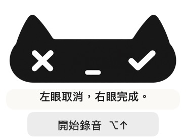
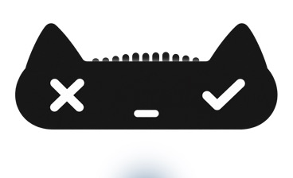

# 少文字互動：首次引導與日常操作

日期：2026-10-14。使用者已同意採用，對應本機 build 8。

## 設計理念

以可辨識的符號承擔日常操作說明，讓小貓保持安靜、緊湊，減少重複閱讀與翻譯負擔。X 與勾號提供形狀差異，珊瑚紅與薄荷綠補充滑入及按下回饋；不能只用顏色區分操作。

首次引導只寫「左眼取消，右眼完成。」使用系統中文字型與自然標點，不加入長篇說明。引導在首次開啟時出現，不會啟用麥克風；開始錄音後即收起。記錄儲存於本機偏好設定，重新啟動與更新版本不會自動重播。日後可從選單「重新查看操作引導…」主動重看。

## 畫面規則

- 錄音：維持 184 × 112 pt 浮窗；不顯示文字與秒數，聲波由左向右，靜音時平整。
- 首次引導：寬度相同，暫增加一行說明至 138 pt 高；下方保留「開始錄音」與目前快捷鍵。
- 滑入：移除自訂文字浮標與系統延遲工具提示，保留珊瑚紅／薄荷綠邊框及光暈，滑出恢復原貌。
- 輔助使用：螢幕閱讀器仍可讀出取消、完成與預覽動作，不以可見文字的刪除犧牲操作語意。
- 狀態與錯誤：辨識、貼上結果與需要處理的錯誤保留必要訊息；本次沒有將所有狀態文字改寫為動畫。

首次說明與錯誤訊息仍可能需要在地化；此方案是減少常駐文字，不是宣稱完全免除多語言支援。

霧黑材質維持定案。液態玻璃稿、原始設計與早期網頁展示均保留，後者作為設計修訂歷程，不代表目前原生介面的每項行為。

## 驗證方式

檢查首次偏好持久化、更新版本不重播、錄音恢復小型尺寸、滑入狀態不產生文字或工具提示、輔助使用名稱，以及既有聲波與按鈕行為。安裝前備份舊版並確認沒有進行中的錄音。

## 本機驗證結果

- 11 組既有離線測試通過，包含首次偏好與無文字滑入檢查。
- build 8 簽章通過，安裝檔與建置檔一致，登入啟動路徑未變。
- 實機首次啟動顯示一行引導；按開始錄音後，引導與開始按鈕收起，畫面只保留小貓與聲波。
- 測試錄音已取消；再次進入預覽沒有重播引導。本輪沒有執行雲端辨識與貼上測試。
- 日常滑入的無文字與紅／綠狀態由聚焦測試驗證；實機截圖保存首次引導與錄音畫面。

