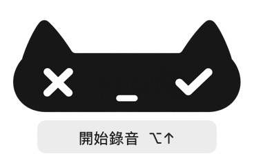
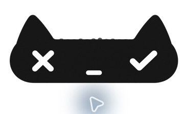

# Living Signal 原生整合與使用說明

更新：2026-10-14。版本：1.1.1（build 6），本機試用版。

## 最新使用者決策

原生錄音 UI 必須小而短暫，不能遮擋主要輸入框。最初 340 × 230 pt 的大卡片被使用者否決，已改成 **184 × 112 pt 的透明浮窗**，面積約減少 74%；貓咪本體寬 180 pt。移除大底板、標題與額外操作說明，僅保留貓咪及處理結果等必要狀態；錄音期間不顯示文字與秒數。左右眼的實際點擊範圍仍各為 44 × 44 pt。

語音輸入與桌面陪伴是兩種不同用途：

| 用途 | 定位 | 目前範圍 |
| --- | --- | --- |
| 語音輸入浮窗 | 螢幕上方中央或下方中央，二選一 | 本機預設上方中央；選單列可切換位置並記住選擇。錄音結束後收起 |
| 桌面陪伴寵物 | 正上方、右上角或使用者自由拖曳 | 保留為後續設計方向；目前沒有將錄音浮窗當成常駐桌面寵物 |

使用者提到的桌面陪伴寵物作為用途與互動的參考，不是此版已串接其他產品的宣稱。語音浮窗不自由漂移，也不預設放在右上角。

## 使用方式

1. 在需要輸入的位置按 **⌥↑** 開始錄音；也可從選單列「小黑貓介面預覽…」按「開始錄音」。
2. 說話時兩耳之間以真實麥克風音量呈現起伏；靜音或量測缺失時頭頂保持平整。
3. **左眼 X** 取消錄音／辨識，紅色滑入提示；**右眼勾號** 結束錄音並開始辨識，薄荷綠提示。再按一次快捷鍵也能結束錄音。
4. 選單列 → **錄音浮窗位置** → **上方中央／下方中央**。預設上方中央，避開常見的下方輸入框。
5. 詞典與學習狀態仍使用既有原生編輯流程，加入同一隻黑貓與暖白視覺。網頁原型的完整雙欄版型尚未逐項移植。

浮窗是非啟用式 AppKit 面板，不能成為 key/main window，避免搶走原輸入目標。語音辨識、Keychain、語言設定、貼上及遠端行為沿用原有服務；本機仍只貼上，不自動送出。

## 保存與回復

- [設計稿與理念](DESIGN_HANDOFF.md)、[報告母稿](REPORT_MATERIALS.md)、所有概念圖、生成提示詞、瀏覽器原型及 GIF 已完整保存在此資料夾。
- 設計原稿保留原貌；本文件中的最新使用者回饋決定原生浮窗的尺寸與定位。
- 安裝位置：`~/Library/Application Support/AI語音輸入/AI語音輸入.app`。
- 原 1.1.0 App 已備份於該資料夾的 `Backups/before-neko-20261014-214620/AI語音輸入.app`；舊設定與 LaunchAgent 也有備份。未重設 Keychain、TCC 或使用者詞條。
- Bundle ID 保持 `tw.panh.FreeVoiceType`；本機建置使用既有 Apple Development 憑證及原 designated requirement。登入啟動路徑保持不變。
- 回復時先結束新版，將備份 App 複製回原安裝位置後啟動；不要以舊偏好設定覆蓋後續新增的使用者詞條。

## 驗證與邊界

- 原有 10 套離線測試基線通過；加入 HUD 後共 11 套通過。
- HUD 聚焦測試涵蓋靜音／缺失音量平整、減少動態、按鈕狀態、44 pt 點擊範圍、不搶焦點、小型尺寸及上下中央定位。
- 建置與嚴格簽章驗證通過；安裝檔與建置檔雜湊一致。
- 實機曾成功開始錄音，觀察到真實波形與計時；點左眼取消後，空白測試文件仍可輸入，暫存錄音及開啟中的錄音檔均為 0。
- 完整語句的 Groq 辨識、實際文字貼入與不同前景 App 的快捷鍵體驗，仍待使用者試用；不能用離線測試或介面預覽代表這些結果。
- 本輪為本機整合，未發布 GitHub、網站或公開版本。

## 已安裝的小型畫面

此為已安裝 build 6 的原生視窗截圖；Retina 截圖為 368 × 224 像素，實際視窗為 184 × 112 pt。大卡片的 [早期畫面](native-evidence/before-compact.png) 與 [實機錄音檢查](native-evidence/recording-before-compact.png) 僅保留作修訂歷程。

## 使用者試用修訂：build 7

- 真實聲紋改為由左往右：最新音量出現在左耳側，既有樣本逐步右移。
- 按使用者確認，錄音時移除「正在聽你說」整行與計時；辨識中及結果等必要狀態保留。
- 保持 184 × 112 pt 小型透明浮窗、原有紅／綠滑入效果與上下中央定位。
- [液態玻璃外觀研究](material-studies/README.md) 僅保存比較稿，未套用到本機程式。
- 舊網頁展示與 GIF 保留為先前設計版本；本節描述本機最新行為。
- 新增聲紋右移及錄音時無可見文字的聚焦檢查，檢查通過。

使用者看過比較後選擇保留目前霧黑設計；液態玻璃僅保存為參考稿。

Build 7 已完成簽章與安裝檔一致性驗證，並啟動實機錄音，確認畫面僅有取消／完成按鈕，沒有下方文字與秒數；測試錄音已取消。本輪未執行完整語音辨識與貼上。

## 少文字互動定案（build 8）

首次顯示「左眼取消，右眼完成。」其後不自動重播；選單可重新查看。平常滑入不顯示任何文字浮標或系統工具提示，保留紅色／薄荷綠效果及輔助使用名稱。詳細規則與設計理念見 [少文字互動](MINIMAL_GUIDANCE.md)。

## 選單列迷你貓（build 9）

常駐選單列舊麥克風已替換為 18 × 18 pt 原生向量貓，所有錄音狀態維持貓形，並保留接力與無障礙語意。[設計稿與理念](menu-bar-icon/README.md) 已保存。全部 11 組離線測試與簽章驗證通過，建置與本機安裝檔一致。

## 固定黑色（build 10）

依使用者提醒，選單列小貓的所有狀態均維持黑色，去除紅色、橙色與白色反轉，以透明挖空符號區分狀態。[黑貓定案稿](menu-bar-icon/black-only/README.md)。
