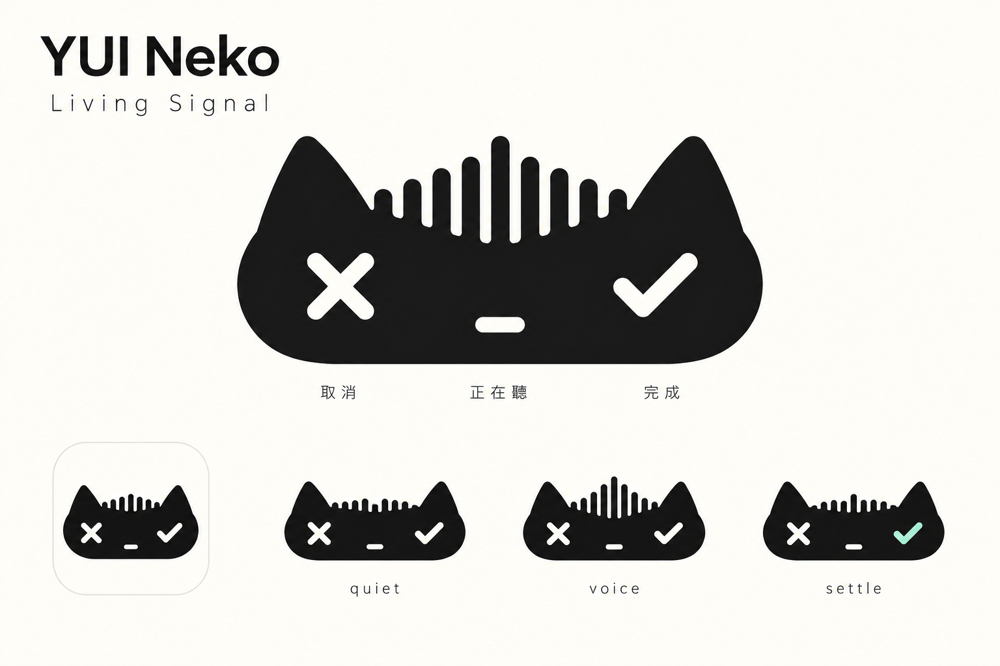

# Living Signal｜可重用的設計理念與展示素材

整理日期：2026-10-14。用途：GitHub 專案介紹、書面報告、簡報及口頭展示。本文件記錄已選定的設計方向；互動原型仍在製作與驗證中。後續實作狀態應另附驗證紀錄更新，不回寫或取代原始概念圖。

## 可直接引用的摘要

Living Signal 是以小黑貓為意象的語音輸入介面設計，將貓耳、聲波與操作符號整合成同一個元件。設計從慵懶貓咪的角色探索出發，依使用者回饋逐步抽象化：聲波在兩耳之間流動，左眼叉號代表取消，右眼勾號代表結束錄音並辨識。此方向讓品牌形象與操作語意共用輪廓，並以固定按鈕位置、狀態文字和減少動態效果兼顧操作清楚度。字典畫面延伸相同視覺語言，區分正式詞條與待確認候選。目前已選定概念稿，互動展示仍在製作與驗證中，尚不代表正式產品整合或辨識效果提升。

## 問題與設計動機

語音輸入浮窗需要在有限空間中呈現收音狀態，以及取消、結束錄音等操作。此次設計從既有的黑色膠囊、叉號、聲波與勾號出發，探索如何保留這些功能，同時建立安靜、慵懶、帶有生命感的品牌形象。

核心構想是「把語音輸入元件本身變成一隻貓」。角色輪廓與功能符號共同構成介面：貓耳框出收音資訊，雙眼承載主要操作，聲音變化讓輪廓產生回應。預期的設計價值是形象一致、操作語意集中；是否更易辨識或操作，仍需後續使用者測試。

## 使用者參與的設計演進

| 階段 | 使用者意圖／回饋 | 設計回應 |
| --- | --- | --- |
| 初始探索 | 小黑貓、慵懶感、語音波動、Logo、字典編輯與自然動作 | 建立三組角色概念，探索浮窗、字典與耳朵／尾巴等動作 |
| 抽象化修訂 | 希望更抽象，多使用符號 | 減少立體與毛髮細節，保留貓耳、頭型、留白與操作記號 |
| 功能整合 | 聲波在耳朵之間流動，叉號與勾號融入貓咪 | 讓波形參與頭部輪廓，將取消和結束錄音整合為雙眼 |
| 方向選定 | 選擇最後一組的第 3 張 | 以 Living Signal 為後續視覺基準，保留其他稿件作演進紀錄 |
| 安靜輪廓修訂 | 不希望安靜時頭頂像梳子 | 將兩耳之間改為平整輪廓，只在說話且有音量時產生波形 |
| 操作提示修訂 | 滑鼠移到取消／完成時，希望有紅色或薄荷綠回饋 | 左眼使用柔紅色，右眼使用薄荷綠，加上光暈、外框及操作文字；鍵盤焦點提供同樣提示 |

此過程是使用者回饋引導的設計迭代，不能稱為已完成的可用性研究、A/B 測試或成效驗證。

## 選定稿與符號語意

建議圖說：**圖 1　Living Signal 選定概念稿。語音波形、取消與結束錄音符號整合於貓咪輪廓；圖內畫面與分鏡為靜態設計示意。**

| 元素 | 表達意義 | 設計約束 |
| --- | --- | --- |
| 黑色貓頭與雙耳 | 安靜、慵懶的小黑貓形象 | 維持簡潔輪廓；小尺寸辨識度待檢查 |
| 兩耳之間的聲波 | 音量隨時間改變，呈現正在聆聽的感覺 | 正式收音須由真實音量驅動；模擬展示須明示 |
| 左眼 X | 取消本次錄音 | 位置及點擊區固定，標籤為「取消錄音」 |
| 右眼勾號 | 結束錄音並進入辨識 | 標籤為「結束錄音並辨識」；不暗示已確認文字正確 |
| 短橫嘴巴 | 克制、平靜的表情 | 保持次要，不與操作符號競爭 |
| 黑、暖白、少量薄荷綠 | 統一 Logo、浮窗與字典的視覺語言 | 顏色搭配圖示及文字，不單靠顏色傳遞狀態 |

這裡的「聲波」是視覺回應，不代表聲紋身份辨識、辨識進度或準確度。

## 互動與可及性規劃

以下是目標行為，並非已通過驗收的功能清單。

| 情境 | 畫面與角色回應 | 操作及可及性要求 |
| --- | --- | --- |
| 開始錄音 | 耳朵輕抬一次，顯示「正在聽你說」 | 明確標示錄音狀態；可取消 |
| 安靜或零音量 | 耳間頭頂保持平整 | 不保留鋸齒或低矮聲波柱，避免像梳子；這是使用者在選定稿後的明確修訂 |
| 持續說話 | 耳間波形平順流動，停聲後回到平整輪廓 | 控制項不隨波形位移；靜音時不繪製聲波柱 |
| 結束錄音 | 停止收音波形，顯示處理狀態 | 防止重複送出，不顯示虛構百分比 |
| 完成或失敗 | 以文字區分已貼入、僅複製、結果待確認及錯誤 | 每個狀態依實際事件決定，提供適當下一步 |
| 字典編輯 | 清單與選中編輯區，區分已加入與待確認 | 儲存候選不等於正式加入；保留未儲存變更提示 |
| 減少動態效果 | 停止耳朵動作及波形平移，保留簡單音量提示 | 仍能讀到狀態、操作名稱及鍵盤焦點 |

搖尾巴、搔癢與伸懶腰保留為角色延伸探索；是否加入須以操作清楚、不干擾輸入為前提。鍵盤操作、輔助標籤、文字對比與動態偏好需要在實作後逐項檢查。

## GitHub 動態展示的呈現方式

2026-10-14 原型更新：已加入左眼「取消錄音」的紅色滑入提示，以及右眼「完成錄音」的薄荷綠提示。符號位置保持固定，以顏色、外框及文字共同說明操作。已在瀏覽器檢查滑鼠移入、鍵盤焦點、300 px 貓咪尺寸及取消／完成的示意狀態轉換；這是原型操作檢查，並非使用者研究或正式 App 整合。

展示截圖：[取消按鈕](living-signal-prototype/evidence/hover-cancel.jpg)、[完成按鈕](living-signal-prototype/evidence/hover-confirm.jpg)、[小尺寸鍵盤焦點](living-signal-prototype/evidence/focus-confirm-actual.jpg)。建議圖說：**Living Signal 操作回饋：左眼以紅色表示取消，右眼以薄荷綠表示結束錄音；操作提示於滑鼠移入或鍵盤聚焦時顯示。**

建議將概念稿、可執行原型與展示錄影分開保存，讓讀者能辨認各自用途。概念稿保存設計選擇；瀏覽器原型展示狀態轉換；GIF 或短片提供不開啟原型也能觀看的預覽。每份動態素材應附版本、產製日期、重現步驟及實際完成的檢查項目。

建議展示順序：待機 → 模擬音量變化 → 結束錄音的狀態轉換 → 取消 → 字典修改 → 減少動態效果。展示若只有模擬資料，畫面及說明應明確寫「互動展示／模擬音量」，不要呈現成真實收音或辨識結果。

可重用的展示說明：

> 本展示用於說明 Living Signal 的視覺與互動構想。聲波、詞條及狀態若為示意資料，會於展示中標示；操作演示不代表已串接麥克風、語音辨識服務或正式詞典。實際支援範圍與驗證結果請以該展示版本的說明為準。

## 範圍與目前證據

| 項目 | 本次可陳述的狀態 |
| --- | --- |
| 角色選擇 | 已選定 Living Signal，原始圖檔與設計理念已保存 |
| 視覺探索 | 初始三稿與抽象化三稿、生成提示詞均可查閱 |
| UI 規格 | 已整理語音浮窗、字典、狀態文案與動態設計要求 |
| 互動展示 | 原型正在製作與驗證；本文件不宣稱已通過操作或可及性測試 |
| GitHub 發布 | 本文件是可重用素材，未據此宣稱已完成遠端發布 |
| 正式 App 與效果 | 未由此次設計工作證實 App 整合、辨識提升、可用性改善或正式上線 |

報告可描述「提出」「選定」「設計」「製作原型」等實際工作。只有在取得對應紀錄後，才使用「已驗證」「已整合」「已發布」；準確率、延遲、滿意度與完成率須來自另行定義的測試，不能由視覺示範推論。

## 素材清單與相對連結

| 素材 | 用途 |
| --- | --- |
| [選定稿：Living Signal](abstract-v2/03-living-signal.png) | 報告主圖與後續視覺基準 |
| [設計交接與選定理由](DESIGN_HANDOFF.md) | 查閱最終視覺決策；早期文件若有衝突，以此為準 |
| [完整 UI 與互動提案](UI_DESIGN.md) | 浮窗、字典、文案及後續驗收條件；包含早期探索內容 |
| [抽象化修訂紀錄](abstract-v2/README.md) | 說明使用者回饋與方向轉變 |
| [Soft Loaf](01-soft-loaf.png)、[Moonlit Familiar](02-moonlit-familiar.png)、[Ink Nap](03-ink-nap.png) | 第一輪角色探索圖 |
| [Signal Face](abstract-v2/01-signal-face.png)、[Ear-to-Ear](abstract-v2/02-ear-to-ear.png) | 第二輪未選方向，供設計比較 |
| [初始生成提示詞](GENERATION_PROMPTS.md)、[抽象化生成提示詞](abstract-v2/GENERATION_PROMPTS.md) | 保留 AI 輔助產製方法與設計意圖 |

概念圖使用 AI 圖像生成工具製作，設計方向由使用者回饋與選擇收斂。保留提示詞可追溯產製過程，但不保證重新生成完全相同的圖片。

## 轉用於不同報告形式

- **書面報告：**依序使用摘要、動機、演進、設計決策、互動、範圍與證據；圖說保留「概念稿／示意」標記。
- **簡報：**將問題、三階段演進、選定稿、互動展示與驗證邊界各製成一頁；每頁保留一個主張及對應素材。
- **GitHub：**以選定稿、短版摘要和操作展示為入口，連結完整理念與版本說明；保留相對目錄結構。
- **口頭展示：**先解釋耳間聲波與雙眼操作，再示範狀態轉換；明說哪些資料為模擬、哪些功能已實測。

轉存 Word、PDF 或簡報時，圖片應嵌入文件，並保留圖說、版本與來源說明。Markdown 本身作為文字母稿；後續新增測試結果時，以實際日期、條件與結果補上獨立段落。

## 原生試用的設計修訂

已將錄音角色整合為 AppKit 非啟用式浮窗，真實音量驅動耳間波形。使用者在實機查看後指出大卡片遮住輸入框，因此收斂為 184 × 112 pt 的透明小浮窗；語音輸入僅採上方或下方中央定位，桌面陪伴寵物才採正上方、右上角或自由拖曳。此回饋說明展示稿的比例不能直接等同實際工作情境。實作、安裝及測試範圍見 [原生整合紀錄](NATIVE_INTEGRATION.md)。
