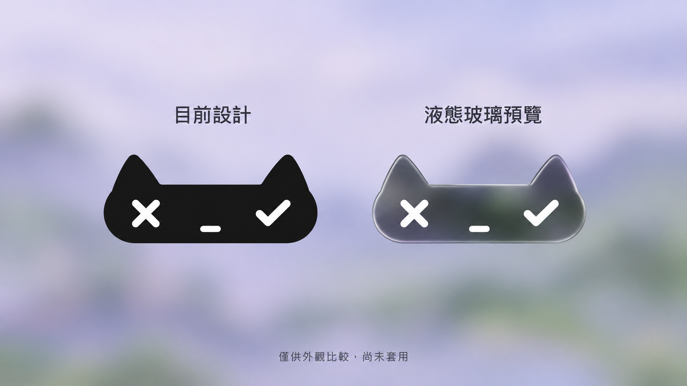

# 液態玻璃外觀研究

日期：2026-10-14。狀態：外觀預覽，尚未套用。

## 設計理念

維持小型、抽象的貓咪輪廓及左右眼取消／完成符號。以深色半透明、柔和折射與薄邊反光呈現懸浮玻璃感，不增加大面積底板。兩個範例為放大材質示意，不代表實際浮窗尺寸。生成圖片並非系統原生 Liquid Glass 的執行截圖。

錄音介面的既定規則保持不變：新聲音從左耳進入、往右耳流動；靜音時頭頂平整；錄音期間移除下方文字與秒數；滑鼠移入取消／完成時分別呈現珊瑚紅與薄荷綠提示。

玻璃材質是否實作，等待使用者看過預覽後決定。若採用，須另驗證深淺背景上的辨識度與系統降低透明度設定。

## 生成規格

參考已安裝 build 6 的 compact-ready.png，保留黑貓比例、X／勾號／短橫嘴；移除下方開始按鈕；同一柔和紫綠背景中並排比較霧黑與煙燻半透明玻璃。禁止增加外框卡片與閒置聲紋。圖中文字使用繁體中文。

使用者看過比較後選擇保留目前霧黑設計；液態玻璃僅保存為參考稿。
