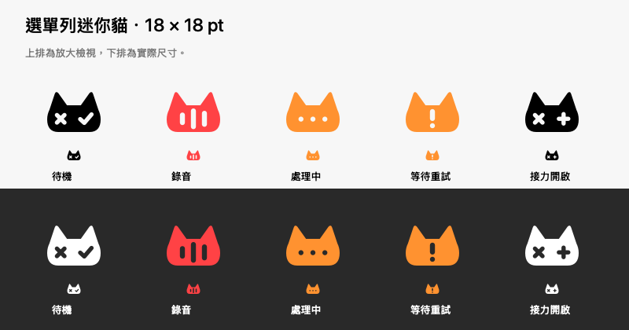

# 選單列迷你貓

> 最新定案：所有狀態固定黑色，見 [黑貓版本](black-only/README.md)。本頁彩色圖為 build 9 歷史稿。

日期：2026-10-14。本機 build 9。

## 設計理念

以 18 × 18 pt 的原生向量模板取代舊麥克風，保留貓耳與 X／勾號，省略嘴巴和細小動態。圖示保持固定尺寸與原有選單列點擊範圍，不因錄音或辨識而跳動。深淺色待機由 macOS 自動決定對比，留白是真正透明挖空。

| 狀態 | 小圖示 |
| --- | --- |
| 待機 | 單色貓，左叉右勾 |
| 錄音 | 紅色貓，三條高低不同的聲紋 |
| 準備／完成錄音／辨識／貼入 | 橙色貓，三點 |
| 等待重試 | 橙色貓，驚嘆號 |
| iPhone 接力待機 | 單色貓，右側改為加號 |

內部符號與顏色共同區分狀態，並保留螢幕閱讀器名稱；選單列的迷你貓整體是開啟選單的按鈕，左右眼不是分開的操作區域。正式錄音浮窗的兩眼操作維持原樣。

預覽圖由與程式相同的 AppKit 向量繪製程式輸出；包含放大與 18 pt 對照，不是實際桌面截圖。RenderPreview.swift 可重建預覽；icon-0 至 icon-4 的 PNG 僅供文件使用，程式使用向量繪製，不依賴縮小點陣圖。

來源：Sources/GroqVoiceInput/NekoMenuBarIcon.swift。
